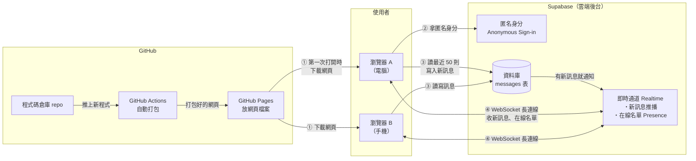
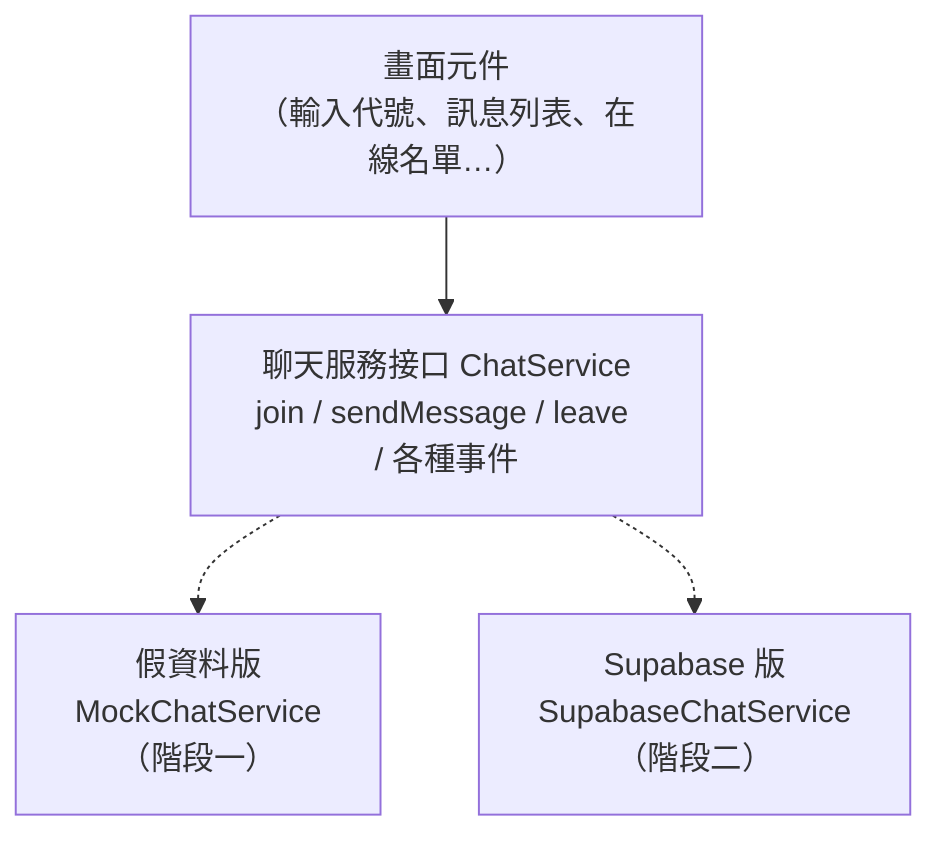
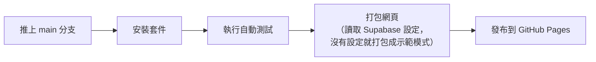

# 匿名聊天室：架構文件

> 這份文件寫給不寫程式的人看。專有名詞第一次出現時，後面會用「（）」補一句解釋。
> 需求來源：[`docs/requirements.md`](requirements.md)，以及需求訪談時確認的 11 個決定（整理在第 1 節）。

---

## 1. 專案說明與目標

### 這是什麼

一個不用註冊、不用登入的匿名聊天室。打開網頁，輸入代號，就能和所有人在同一個聊天室裡聊天。電腦和手機都能用。

### 目標

- 任何人拿到網址就能用，不用安裝任何東西。
- 看得到誰在線上，有人進來或離開時會有提示。
- 不用花錢：網頁放在 GitHub Pages，即時傳訊用 Supabase 的免費方案。
- 分兩步做：先做出「看得到、摸得到」的畫面，最後才接上真正的即時傳訊。

### 訪談時確認的規則

| # | 主題 | 決定 |
|---|---|---|
| 1 | 歷史訊息 | 剛進來時看得到最近 50 則 |
| 2 | 代號重複 | 跟目前在線上的人重複時會擋下來，判斷時不分大小寫（Tom = tom） |
| 3 | 記住代號 | 下次打開時，上次的代號會先幫你填好，按一下就能進去 |
| 4 | 可以送的內容 | 只能送純文字（含 emoji），網址點不下去，每則最多 500 字 |
| 5 | 訊息樣式 | 像 LINE：自己的靠右，別人的靠左，顯示代號和時間 |
| 6 | 進出提示 | 夾在對話裡的置中灰字，短暫斷線不會出現提示 |
| 7 | 在線名單 | 電腦版放在側邊欄，手機版只顯示人數，點一下才展開名單 |
| 8 | 代號規則 | 1–20 個字，不能用「系統」、「管理員」、「admin」這類名字 |
| 9 | 防洗版 | 每人每秒最多送 1 則，沒有管理員 |
| 10 | 斷線 | 頂部出現提示條，會自動重新連線，並補上斷線期間錯過的訊息 |
| 11 | 未讀提醒 | 分頁標題顯示未讀數，例如「(3) 匿名聊天室」 |

### 我自己先決定的小規則

- 介面只有繁體中文。
- 聊天室畫面有「離開」按鈕，按了會回到輸入代號的畫面。
- 往上捲去看舊訊息時，有新訊息不會把畫面強制拉回最下面，而是在下方顯示「↓ 有新訊息」按鈕。
- 進出提示只有當下在線上的人看得到，不會出現在「最近 50 則」裡。
- 資料庫只保留最近 1000 則訊息，更舊的會自動刪掉。

---

## 2. 整體架構圖

先說明圖裡的三個角色：

- **瀏覽器**：使用者的 Chrome、Safari 等。聊天室的程式全部在這裡執行。
- **GitHub Pages**（GitHub 提供的免費網頁空間）：只負責把網頁檔案交給瀏覽器，之後就不參與聊天了。
- **Supabase**（一個雲端後台服務，內建資料庫和即時傳訊功能）：負責存訊息、即時轉發訊息，以及記錄誰在線上。



**看圖重點：**

1. GitHub Pages 只在「打開網頁」那一刻有用，之後所有聊天都是瀏覽器直接和 Supabase 溝通。
2. **WebSocket**（瀏覽器和伺服器之間一條一直開著的連線）讓 Supabase 能主動把新訊息推給每個人，不用一直重新整理。
3. 這個專案**沒有自己的伺服器**。所有規則（字數、速度限制等）不是在瀏覽器裡檢查，就是在 Supabase 的資料庫裡檢查。

---

## 3. 技術選擇

### 前端（使用者在瀏覽器裡看到、操作的部分）

| 項目 | 選了什麼 | 為什麼 |
|---|---|---|
| 語言 | **TypeScript**（多了「型別檢查」的 JavaScript，寫錯資料格式時，程式還沒執行就會先報錯） | 瀏覽器只看得懂 JavaScript，而 TypeScript 最後也會轉成 JavaScript。選它是因為第 5 節的「通訊約定」可以直接寫成型別：假資料版和 Supabase 版只要格式不一致就會報錯，換階段時比較不容易出錯。 |
| 畫面框架 | **React**（目前最多人用的畫面元件工具，把畫面拆成一塊一塊可以重複使用的「元件」） | 聊天室的畫面一直在變（新訊息、有人進出、連線狀態），React 擅長「資料一變，畫面自動跟著更新」。`/frontend-design` 產出的程式碼大多也是 React，可以直接拿來用。 |
| 打包工具 | **Vite**（把原始碼打包成瀏覽器能直接執行的檔案，開發時也能即時預覽） | 設定少、速度快，打包出來是純靜態檔案，剛好可以直接放上 GitHub Pages。 |
| 樣式 | 交給 `/design` 和 `/frontend-design` 決定 | 這份文件不規定顏色和樣式。 |

**沒有選的：**

- 不寫框架、直接寫原始 HTML：檔案少很多，可是「訊息、在線名單、連線狀態」同時在變的時候，很容易出現畫面跟資料對不上的問題。
- Next.js 這類要有伺服器的框架：GitHub Pages 只能放靜態檔案，用不到它的伺服器功能。

### Supabase 用哪些功能

| 功能 | 用來做什麼 | 為什麼 |
|---|---|---|
| **Database（資料庫，PostgreSQL）**：一張 `messages` 表 | 存訊息，讓新進來的人看得到最近 50 則 | 只靠即時傳訊的話，訊息送出去就沒了，新進來的人看不到之前的對話。要有「最近 50 則」，就一定要存下來。 |
| **Realtime：Postgres Changes**（資料庫有新資料時，自動推給訂閱的人） | 有人送出訊息時，所有人即時收到 | 訊息「先存進資料庫，再推播」，存檔和推播就不會不一致：每則推出去的訊息都一定已經存好，也一定已經通過資料庫的檢查。 |
| **Realtime：Presence**（記錄「誰現在連著」，有人連上或斷開時通知大家） | 在線名單、進出提示、檢查代號有沒有重複 | 這正是 Presence 的用途。使用者關掉分頁時，Supabase 會自動把他移出名單，不用我們自己處理。 |
| **Anonymous Sign-ins（匿名登入）** | 每個瀏覽器在背景自動拿到一個隨機身分編號，**使用者完全看不到，也不用輸入任何東西** | 規則需要知道「誰」在送訊息，才能限制「每人每秒 1 則」。有了這個編號，資料庫就能用 RLS 確保每個人只能用自己的編號送訊息。這個編號會存在瀏覽器裡，重新整理後還是同一個，所以重新整理不會被當成「另一個人」。 |
| **RLS（Row Level Security，資料列安全規則）** | 規定誰可以讀、誰可以寫哪些資料 | 金鑰會公開在網頁裡（見第 8 節），真正的保護靠 RLS：任何人都能讀訊息，但只能用自己的身分新增訊息，不能修改或刪除任何訊息。 |
| **Database Trigger（觸發器，資料寫入前自動執行的檢查）** | 在資料庫裡檢查字數、送出速度、保留字代號，並刪除太舊的訊息 | 瀏覽器裡的檢查擋得住一般使用者，但擋不住懂技術、直接呼叫 Supabase 的人，所以重要的規則要在資料庫裡再檢查一次。 |

**沒有用的：**

- **Realtime Broadcast**（不經過資料庫，直接轉發訊息）：速度快，可是訊息不會存下來，而且沒辦法在資料庫層檢查規則。
- **Edge Functions**（在 Supabase 上執行的小程式）：這一版的規則用資料庫就能檢查，少一個零件就少一個可能出錯的地方。

---

## 4. 兩個階段

### 關鍵設計：「聊天服務」接口

為了讓階段一做的畫面在階段二完全不用重寫，畫面**不直接和 Supabase 溝通**，而是透過一個中間層，叫做「**聊天服務接口**（ChatService，規定『聊天服務要提供哪些功能』的一份清單）」。



打個比方，畫面就像電器，接口就像插座。階段一插的是「電池」（假資料），階段二換成「市電」（Supabase），電器本身完全不用改。

接口規定了哪些動作和事件，詳見第 5 節。程式啟動時會自動選要用哪一版：

- 有設定 Supabase 的網址和金鑰 → 用 Supabase 版。
- 沒有設定 → 用假資料版，畫面角落顯示「示範模式」標籤，避免有人以為是真的聊天室。

另外，**檢查規則的程式只寫一份**（代號長度、保留字、訊息字數），兩個版本和畫面都共用，這樣規則永遠只有一個版本。

### 階段一：還沒接 Supabase

**目標：除了「真的和別人聊天」之外，所有畫面和行為都能在 GitHub Pages 上看到、點到、測到。**

假資料版會做這些事：

| 功能 | 假資料版的做法 |
|---|---|
| 最近 50 則 | 進來時產生 50 則預先寫好的假對話，時間包含今天和前幾天（可以測試日期顯示） |
| 其他使用者 | 有 3 個假的機器人使用者（例如「小明」、「阿花」、「路人甲」）會隨機說話、離開、再進來 |
| 同一台電腦開兩個分頁互相聊天 | 用 **BroadcastChannel**（瀏覽器內建功能，讓同一個瀏覽器的分頁互傳訊息）。同一個瀏覽器開兩個分頁、取不同代號，就能互相看到訊息，也看得到在線名單和進出提示。換一台裝置就看不到了，這是假資料版的限制。 |
| 代號重複 | 輸入機器人的名字（例如「小明」或「XIAOMING」的不同大小寫）會被擋下來 |
| 速度限制 | 跟真的版本一樣，1 秒內送第二則會顯示「太快了，稍等一下」 |
| 斷線 | 有一個只在示範模式出現的「測試面板」，可以按「模擬斷線」、「模擬重新連線」、「模擬有人搶走你的代號」 |

**怎麼在 GitHub Pages 上看到效果：** 推上 GitHub 之後，GitHub Actions 會自動打包並發布（第 12 節），網址是：

**https://justinchang1070028-netizen.github.io/C3/**

用電腦打開，再用手機打開，就能分別確認兩種版面。

### 階段二：接上 Supabase

**會改變的：**

1. 在 Supabase 建立專案，執行一份建表用的 SQL 檔案（`supabase/migrations/` 裡的檔案，內容是建立 `messages` 表、RLS 規則和觸發器），並開啟「匿名登入」。
2. 新增 `SupabaseChatService`，照著同一個接口實作。
3. 在 GitHub 設定 Supabase 的網址和公開金鑰（第 8 節）。下次打包時，程式偵測到這兩項設定，就會自動改用 Supabase 版。

**不會改變的：** 所有畫面元件、檢查規則的程式、通訊約定。

**保留的：** 假資料版不刪除。本機開發、或者沒填 Supabase 設定時，還是會用假資料版，以後改畫面時不用連上真的資料庫。

---

## 5. 通訊約定

這是畫面和「聊天服務」之間的約定。不管是假資料版還是 Supabase 版，都要完全照這份約定。

### 5.1 資料格式

**訊息（Message）**：聊天訊息，會存在資料庫裡

```json
{
  "id": 1024,
  "senderId": "8f14e45f-ceea-467a-9a2b-1c3d5e6f7a8b",
  "nickname": "小明",
  "content": "大家好！",
  "createdAt": "2026-10-13T06:32:05.123Z"
}
```

| 欄位 | 說明 |
|---|---|
| `id` | 流水號，越新的訊息越大。用來排序，斷線後補訊息時用來判斷從哪一則開始補，也用來避免同一則訊息重複出現。 |
| `senderId` | 送出者的匿名身分編號。畫面用它判斷「這則是不是我送的」（決定靠左或靠右），**不會顯示出來**。 |
| `nickname` | 送出當時的代號，1–20 字。 |
| `content` | 訊息內容，純文字，1–500 字，可以換行。 |
| `createdAt` | 伺服器記錄的送出時間（世界標準時間），畫面會轉成使用者當地的時間顯示。 |

**在線使用者（OnlineUser）**：Presence 裡的每一個人

```json
{
  "userId": "8f14e45f-ceea-467a-9a2b-1c3d5e6f7a8b",
  "nickname": "小明",
  "joinedAt": "2026-10-13T06:30:00.000Z"
}
```

**系統提示（SystemNotice）**：進出提示，只存在使用者自己的瀏覽器畫面裡，不存進資料庫

```json
{
  "kind": "join",
  "nickname": "小明",
  "at": "2026-10-13T06:30:00.000Z"
}
```

`kind` 是 `"join"`（加入）或 `"leave"`（離開）。

**連線狀態（ConnectionStatus）**：以下四種之一

| 值 | 意思 |
|---|---|
| `connecting` | 第一次連線中 |
| `connected` | 正常連線 |
| `reconnecting` | 斷線了，正在重新連線 |
| `disconnected` | 已經離開聊天室（按了「離開」） |

### 5.2 畫面可以要求的動作

| 動作 | 帶的資料 | 可能的結果 |
|---|---|---|
| `join` 進入聊天室 | 代號 | `ok`：成功，並附上最近 50 則訊息<br>`nickname_taken`：代號有人在用<br>`nickname_invalid`：代號不符合規則（附上原因）<br>`network_error`：連不上 |
| `sendMessage` 送出訊息 | 訊息內容 | `ok`：成功，並附上存好的訊息<br>`too_fast`：太快了<br>`invalid`：空白，或超過 500 字<br>`offline`：目前斷線中 |
| `leave` 離開 | 無 | 一定成功 |

### 5.3 聊天服務會主動通知畫面的事件

| 事件名稱 | 帶的資料 | 什麼時候發生 |
|---|---|---|
| `message:new` | Message | 有任何人（包括自己）送出新訊息 |
| `presence:sync` | OnlineUser 清單 | 在線名單有變動時，送出完整的最新名單 |
| `presence:join` | SystemNotice | 有人加入（已經排除短暫斷線，見第 6 節） |
| `presence:leave` | SystemNotice | 有人離開（已經排除短暫斷線） |
| `connection:status` | ConnectionStatus | 連線狀態改變 |
| `session:kicked` | 原因 | 代號被別人搶走，要回到輸入代號的畫面（見第 6 節） |

### 5.4 在 Supabase 裡的對應（階段二）

| 約定 | Supabase 的實際做法 |
|---|---|
| 聊天室 | 一個名為 `room:lobby` 的 Realtime 頻道 |
| `message:new` | 訂閱 `messages` 表的「新增資料」事件（Postgres Changes） |
| `sendMessage` | 在 `messages` 表新增一筆資料 |
| 在線名單 | 在 `room:lobby` 頻道上，用 Presence 登記自己的 `{ userId, nickname, joinedAt }` |
| `presence:sync / join / leave` | 由 Presence 的 sync / join / leave 事件轉換而來 |

**`messages` 表的欄位與規則：**

| 欄位 | 型別 | 規則 |
|---|---|---|
| `id` | 自動遞增的整數 | 主鍵（每一筆資料唯一的編號） |
| `sender_id` | 身分編號 | 自動填入目前登入的匿名身分，不能冒用別人的 |
| `nickname` | 文字 | 去掉頭尾空白後 1–20 字，不能是保留字 |
| `content` | 文字 | 去掉頭尾空白後 1–500 字 |
| `created_at` | 時間 | 由伺服器自動填入，不能自己指定 |

- **RLS 規則：** 所有人都可以讀；只有已經拿到匿名身分的人可以新增，而且 `sender_id` 必須是自己；所有人都不能修改或刪除。
- **觸發器：** 新增訊息前，先檢查同一個 `sender_id` 上一則訊息是不是在 1 秒內，是的話就拒絕並回傳 `too_fast`。新增訊息後，刪除最新 1000 則以外的舊訊息。

---

## 6. 資料流

### 6.1 進入聊天室

1. 使用者打開網頁。程式從瀏覽器的 **localStorage**（瀏覽器裡一個可以長期存小資料的地方）讀出上次的代號，如果有，就先幫他填好。
2. 使用者按「進入」。
3. **瀏覽器先檢查**：去掉頭尾空白、統一全形和半形字元的寫法、去掉看不見的字元，然後檢查是否為 1–20 字、是否為保留字。不符合規則就在欄位下方顯示原因，不會送出。
4. 如果瀏覽器還沒有匿名身分，就向 Supabase 拿一個；已經有的話就沿用。
5. 連上 `room:lobby` 頻道，等 Presence 送來目前的在線名單。
6. **檢查代號有沒有重複**：如果名單裡有**其他身分**用了同一個代號（不分大小寫），就離開頻道，顯示「這個代號已經有人用了」。如果是**同一個身分**（例如同一個瀏覽器開了兩個分頁），就算同一個人，可以進入。
7. 在 Presence 登記自己。
8. 開始接收新訊息，然後讀取最近 50 則（先開始接收、再讀取，中間才不會漏掉訊息；同一則訊息如果收到兩次，會依照 `id` 只留一則）。
9. 把代號存進 localStorage，切換到聊天室畫面，捲到最下面。

**兩個人同時取同一個代號的情況：** 在第 6 步，兩個人都還沒登記，所以檢查都會通過。登記之後，雙方都會在名單裡看到對方，這時**比較晚加入的人**會收到 `session:kicked`，回到輸入代號的畫面，並看到「這個代號剛好被別人搶先使用了」。如果加入時間完全相同，就比較身分編號，讓結果固定。

### 6.2 送出訊息

1. 使用者在輸入框打字。電腦上按 Enter 送出、Shift+Enter 換行；手機上按「送出」按鈕。
2. **瀏覽器先檢查**：內容是不是空白、有沒有超過 500 字、距離上一則是不是不到 1 秒、目前是不是斷線中。沒通過就不送出，在輸入框下方顯示原因，例如「太快了，稍等一下」。
3. 把訊息新增到 `messages` 表。
4. **資料庫再檢查一次**（RLS + 觸發器）。沒通過就回傳錯誤，畫面顯示相同的提示。
5. 新增成功後，畫面馬上顯示這則訊息（靠右），並清空輸入框、捲到最下面。
6. 資料庫透過 Realtime 把這則訊息推給所有人，包括自己（自己收到時會依照 `id` 發現已經顯示過，不會重複出現）。
7. 其他人收到後：
   - 如果他正在看最下面 → 自動捲到最下面。
   - 如果他往上捲去看舊訊息 → 不移動畫面，在下方顯示「↓ 有新訊息」。
   - 如果他的分頁在背景 → 分頁標題的未讀數 +1，例如「(3) 匿名聊天室」。

### 6.3 離開

**按「離開」按鈕：**

1. 從 Presence 取消登記，並斷開頻道。
2. 回到輸入代號的畫面，代號還是幫你填好的。
3. 其他人的在線名單裡少了這個人，對話中出現「── 小明 離開了聊天室 ──」。

**直接關掉分頁或瀏覽器：**

1. 連線中斷後，Supabase 會自動把他從 Presence 移除。
2. 其他人的瀏覽器收到「離開」事件後，**先等 15 秒**。
3. 如果 15 秒內同一個身分又回來了（例如只是重新整理），就當作沒發生過，不顯示任何提示。
4. 超過 15 秒還沒回來，才從在線名單移除，並顯示離開提示。

「加入」提示也一樣：如果某人才剛「離開」不到 15 秒就回來，就不顯示「加入」提示。另外，剛進入聊天室時，名單裡原本就在的人不會跳出「加入」提示。

### 6.4 斷線與重新連線

1. 偵測到斷線的情況：網路中斷、Supabase 頻道回報錯誤或逾時，或手機從背景切回來時發現連線已經斷了。
2. 頂部出現提示條「連線中斷，正在重新連線…」，送出按鈕暫時不能按（可以繼續打字）。
3. Supabase 的程式會自動重試連線。網路恢復時，我們也會主動要求它馬上重試，不用等它的下一次重試。
4. 重新連上之後：
   1. 重新檢查代號：如果斷線期間有別人用了你的代號，你會回到輸入代號的畫面，並看到說明。
   2. 重新在 Presence 登記自己。
   3. 補上錯過的訊息：讀取所有 `id` 比手上最新一則還大的訊息（最多 50 則；如果錯過超過 50 則，就直接換成最新的 50 則，並在對話中顯示「── 已略過部分較舊的訊息 ──」）。
   4. 提示條變成「已重新連線」，2 秒後自動消失，送出按鈕恢復可以按。
5. 斷線不到 15 秒的話，其他人不會看到你「離開又加入」（見 6.3）。

---

## 7. 畫面清單

只寫「有什麼」和「做什麼」，不規定長相。

### 畫面 A：輸入代號

| 元素 | 行為 |
|---|---|
| 聊天室名稱 / 簡短說明 | 例如「匿名聊天室：輸入代號就能開始聊」 |
| 代號輸入框 | 打開頁面時自動帶入上次的代號，游標停在輸入框。最多輸入 20 字。按 Enter 等於按「進入」。 |
| 「進入」按鈕 | 輸入框是空的時候不能按。按下後顯示「連線中…」，期間不能重複按。 |
| 錯誤訊息區 | 顯示在輸入框下方：「代號不能空白」、「代號最多 20 字」、「這個代號不能使用」、「這個代號已經有人用了」、「這個代號剛好被別人搶先使用了」、「連不上聊天室，請稍後再試」 |
| 示範模式標籤 | 只在階段一的假資料版出現 |

### 畫面 B：聊天室

**頂部列**

| 元素 | 行為 |
|---|---|
| 聊天室名稱 | 只顯示文字 |
| 在線人數「🟢 12 人在線」 | 手機版：點一下展開在線名單（從側邊滑出，或從下方往上展開）。電腦版：只顯示人數，名單已經在側邊欄。 |
| 「離開」按鈕 | 見 6.3 |

**連線提示條**（在頂部列下方，平常不出現）

| 狀態 | 顯示 |
|---|---|
| 重新連線中 | 「連線中斷，正在重新連線…」，一直顯示到連回來 |
| 剛連回來 | 「已重新連線」，2 秒後自動消失 |

**訊息列表**（佔畫面大部分空間，可以上下捲動）

| 元素 | 行為 |
|---|---|
| 別人的訊息 | 靠左。上方顯示代號，旁邊顯示時間。 |
| 自己的訊息 | 靠右。不顯示代號，旁邊顯示時間。 |
| 時間格式 | 今天的訊息顯示「14:32」，不是今天的顯示「10/12 14:32」 |
| 訊息內容 | 純文字，保留換行。網址只是一般文字，點不下去。很長、沒有空白的字串會自動換行，不會把畫面撐開。 |
| 進出提示 | 置中的灰字，例如「── 小明 加入了聊天室 ──」 |
| 「↓ 有新訊息」按鈕 | 只在往上捲、而且有新訊息時出現。點了就捲到最下面，按鈕消失。 |
| 空的聊天室 | 還沒有任何訊息時，顯示「還沒有人說話，來打聲招呼吧」 |

**輸入區**（固定在畫面最下方）

| 元素 | 行為 |
|---|---|
| 訊息輸入框 | 可以打多行，高度隨內容長高，但有上限。電腦上 Enter 送出、Shift+Enter 換行；手機上按 Enter 是換行。 |
| 剩餘字數 | 剩不到 50 字時才出現，例如「還可以輸入 32 字」 |
| 「送出」按鈕 | 內容空白、超過 500 字或斷線中時不能按 |
| 錯誤提示 | 在輸入框上方短暫出現：「太快了，稍等一下」、「訊息最多 500 字」、「送出失敗，請再試一次」 |

**在線名單**（電腦版在右側邊欄，手機版收起來）

| 元素 | 行為 |
|---|---|
| 標題「在線 12 人」 | |
| 名單 | 自己排第一個，後面加上「（你）」。其他人依照加入時間排序。 |

**分頁標題**

- 平常：「匿名聊天室」
- 分頁在背景、而且有別人的新訊息時：「(3) 匿名聊天室」（自己的訊息和進出提示不算）
- 切回這個分頁時，馬上恢復成「匿名聊天室」

**測試面板**（只在示範模式出現）

- 按鈕：「模擬斷線」、「模擬重新連線」、「模擬有人搶走你的代號」、「讓機器人說話」

---

## 8. 金鑰

### 這個專案會碰到的金鑰和設定值

| 名稱 | 是什麼 | 可以公開嗎 | 放在哪裡 |
|---|---|---|---|
| **Project URL**（專案網址） | 你的 Supabase 專案網址，例如 `https://abcd1234.supabase.co` | ✅ 可以 | 本機：`.env.local`<br>GitHub：Repository variables |
| **Publishable key**（公開金鑰，舊名稱是 `anon` key） | 讓網頁能連上你的 Supabase，開頭是 `sb_publishable_`（舊版是一長串 `eyJ...`） | ✅ 可以，**本來就會出現在網頁裡** | 本機：`.env.local`<br>GitHub：Repository variables |
| **Secret key**（祕密金鑰，舊名稱是 `service_role` key） | 擁有整個專案最高權限，**會略過所有 RLS 規則** | ❌ **絕對不能公開** | **這個專案用不到，不要複製到任何地方** |
| **Database password**（資料庫密碼） | 建立 Supabase 專案時自己設定的密碼 | ❌ **絕對不能公開** | 只放在你自己的密碼管理工具裡 |
| **Supabase 帳號密碼** | 登入 Supabase 網站用的 | ❌ 不能公開 | 你自己的密碼管理工具 |

### 為什麼公開金鑰可以公開？

網頁裡的程式會被下載到每個人的瀏覽器裡，任何人只要打開開發者工具，都看得到網頁用了哪把金鑰。所以「放在網頁裡的金鑰」本來就**不可能保密**。

Supabase 的設計就是這樣：公開金鑰只等於「可以來敲門」，能做什麼事是由 RLS 規則決定（第 5.4 節）。就算別人拿走公開金鑰，也只能做一般使用者本來就能做的事：讀訊息，以及用自己的匿名身分送訊息。

祕密金鑰則是「萬能鑰匙」，可以略過所有規則、刪光資料。這個專案沒有自己的伺服器，用不到它，所以**乾脆不要拿出來**。

### 怎麼產生

1. 到 supabase.com 註冊並建立新專案，設定資料庫密碼，並立刻存進密碼管理工具。
2. 進入專案的 **Project Settings → API Keys**，就能看到 Project URL 和 Publishable key。這兩項是 Supabase 自動產生的，不用自己做。
3. 不需要點開或複製 Secret key。

### 放在哪裡

- **本機開發：** 在專案根目錄建立 `.env.local` 檔案，內容如下：
  ```
  VITE_SUPABASE_URL=https://abcd1234.supabase.co
  VITE_SUPABASE_PUBLISHABLE_KEY=sb_publishable_xxxxxxxx
  ```
  開頭是 `VITE_` 的設定，Vite 打包時會**寫進網頁檔案裡**。所以有一條鐵則：**開頭是 `VITE_` 的設定，只能放可以公開的值**。
- **GitHub 自動打包時：** 到 repo 的 **Settings → Secrets and variables → Actions → Variables**，新增上面這兩項。這兩項本來就會公開，所以放在 Variables，不需要放在 Secrets。
- **repo 裡的範例檔：** `.env.example` 會放進 GitHub，只列出名稱、不填值，讓人知道要設定哪些項目。

### 怎麼避免被 commit 到 GitHub

1. 專案目前的 `.gitignore`（告訴 git 哪些檔案不要上傳的清單）**已經包含** `.env` 和 `.env.*`，只排除 `.env.example`，所以 `.env.local` 不會被上傳。
2. 祕密金鑰根本不會出現在電腦上，自然也不會被上傳。這是最可靠的防線。
3. 到 GitHub repo 的 **Settings → Code security** 開啟 **Secret scanning** 和 **Push protection**（GitHub 會自動掃描並擋下含有金鑰的上傳）。
4. 萬一祕密金鑰真的外流，到 Supabase 的 API Keys 頁面**重新產生一把**，舊的就會失效。

---

## 9. 安全與限制

### 別人可能送進來的奇怪東西，以及怎麼擋

一個重要觀念：**瀏覽器裡的檢查只是為了讓使用者體驗好，真正的防線在資料庫。** 懂技術的人可以完全不經過我們的網頁，直接拿公開金鑰呼叫 Supabase。

| 奇怪的東西 | 可能造成的問題 | 前端怎麼擋 | 資料庫怎麼擋 |
|---|---|---|---|
| 訊息裡有 HTML 或程式碼，例如 `<script>` | **XSS**（在別人的瀏覽器執行惡意程式） | React 預設會把所有內容當成純文字顯示；**規定不准使用** React 的 `dangerouslySetInnerHTML`（把文字當成 HTML 顯示的功能） | 不需要，因為存進來的內容一律當純文字 |
| 超長訊息 | 畫面卡住、資料庫被塞滿 | 輸入框最多 500 字 | 資料庫規則：超過 500 字就拒絕 |
| 空白訊息、只有空格或換行的訊息 | 洗版 | 去掉頭尾空白後，空的就不能送出 | 資料庫規則：去掉頭尾空白後不能是空的 |
| 很長、沒有空白的字串 | 把版面撐開 | 用樣式設定強制換行 | — |
| 大量換行 | 一則訊息佔滿整個畫面 | 連續 3 行以上的空行縮成 2 行，單則訊息最多顯示 20 行，超過的部分要點「展開」才看得到 | — |
| 洗版（短時間大量送出） | 聊天室被淹沒 | 1 秒內不能送第二則 | 觸發器：同一個身分 1 秒內只能送 1 則 |
| 冒充官方的代號，例如「系統」、「Admin」 | 誤導其他人 | 檢查保留字（不分大小寫） | 觸發器：同樣檢查保留字 |
| 用看起來一樣的字繞過，例如「Ａｄｍｉｎ」（全形）、「ad​min」（中間夾了看不見的字元） | 繞過保留字檢查 | 先統一全形和半形、去掉看不見的字元，再檢查 | 觸發器做同樣的處理 |
| 假造別人的 `sender_id` | 冒充別人送訊息 | — | RLS：`sender_id` 必須是自己的身分 |
| 修改或刪除別人的訊息 | 竄改紀錄 | 畫面沒有這個功能 | RLS：所有人都不能修改或刪除 |

### 誠實說明：擋不住的事

- **代號沒辦法百分之百防冒用。** 因為沒有登入，「代號不能重複」是靠在線名單互相檢查做到的。懂技術的人可以繞過網頁，直接用跟別人一樣的代號送訊息。不過他的匿名身分編號會不同，而畫面判斷「是不是我送的」是看身分編號，所以他沒辦法讓訊息出現在你的右側。
- **速度限制可以被繞過。** 一個人可以一直申請新的匿名身分，假裝成很多人。Supabase 預設會限制同一個 IP 每小時申請匿名身分的次數（預設約 30 次，可以在後台調整），這已經能擋掉大部分的狀況。如果真的被大量攻擊，下一步是加上 CAPTCHA（「我不是機器人」驗證），見第 10 節。

### 免費方案的上限

以下數字是寫這份文件時（2026 年 10 月）的大約值，**正式上線前請到 Supabase 和 GitHub 的價格頁面再確認一次**，因為這些數字可能會調整。

**Supabase 免費方案**

| 項目 | 大約上限 | 對這個專案的影響 |
|---|---|---|
| 同時連線數 | 約 200 個 | 同時大約 200 人在線就滿了。超過的人會連不上，會看到「連不上聊天室」。 |
| Realtime 訊息量 | 每月約 200 萬則 | 注意：1 則聊天訊息推給 100 個人，就算 100 則。人多的時候用量會增加得很快。 |
| 資料庫容量 | 500 MB | 只保留 1000 則訊息，遠遠用不完 |
| 每月活躍使用者 | 約 5 萬 | 匿名身分也算在內。清除瀏覽器資料的人會被算成新的使用者。 |
| **閒置暫停** | **連續約 7 天沒有任何活動，專案就會被暫停** | ⚠️ **最需要注意的一項。** 暫停後聊天室會連不上，要到 Supabase 後台手動恢復。 |

**GitHub Pages**

| 項目 | 上限 | 對這個專案的影響 |
|---|---|---|
| repo 是否公開 | 免費帳號的 Pages 需要 **public repo** | 程式碼會公開。這沒關係，因為裡面沒有任何祕密（第 8 節）。 |
| 網站大小 | 1 GB | 這個專案只有幾 MB |
| 每月流量 | 約 100 GB（建議值） | 網頁檔案很小，而且聊天流量走 Supabase，不會用到 GitHub 的流量 |

---

## 10. 這一版刻意不做的事

| 不做的事 | 為什麼 |
|---|---|
| 註冊、登入 | 需求明確寫了不需要 |
| 管理員（刪訊息、踢人） | 管理員一定要能證明自己的身分，也就是要有登入，跟「不用登入」的方向衝突 |
| 圖片、檔案 | 要處理不當圖片、儲存空間和流量，第一版太複雜 |
| 可以點的連結 | 匿名環境下，容易被拿來貼釣魚或廣告網址 |
| 多個聊天室、私訊 | 需求是所有人在同一個聊天室 |
| 斷線時先打好訊息，連回來再送出 | 排隊太久的話，訊息順序容易跟別人的對不上，畫面也比較難說清楚狀態 |
| 提示音、系統通知 | 提示音容易吵到人；系統通知要使用者授權，而且在手機瀏覽器（特別是 iPhone）上不穩定 |
| 編輯或收回自己的訊息 | 每個人都要能改「已經推給所有人」的訊息，會讓規則和畫面都變複雜 |
| 「對方正在輸入…」、已讀 | 不是核心需求，而且會大量增加 Realtime 的用量（第 9 節的免費上限） |
| 個人封鎖（隱藏某人的訊息） | 訪談時決定第一版先不做 |
| 往上捲載入更舊的訊息 | 需求是最近 50 則 |
| CAPTCHA | 會增加進入聊天室的步驟。等真的被大量攻擊再加。 |
| 多國語言 | 介面只有繁體中文 |

---

## 11. repo 的資料夾結構

```
C3/
├── .github/
│   └── workflows/
│       └── deploy.yml            ← 自動打包並發布到 GitHub Pages 的設定
├── docs/
│   ├── requirements.md           ← 需求說明
│   └── architecture.md           ← 這份文件
├── public/                       ← 原封不動放上網站的檔案（網站小圖示等）
├── src/                          ← 所有前端原始碼
│   ├── main.tsx                  ← 程式的起點
│   ├── App.tsx                   ← 決定現在要顯示「輸入代號」還是「聊天室」
│   ├── screens/                  ← 整個畫面
│   │   ├── NicknameScreen.tsx    ← 畫面 A：輸入代號
│   │   └── ChatScreen.tsx        ← 畫面 B：聊天室
│   ├── components/               ← 畫面上的零件
│   │   ├── MessageList.tsx       ← 訊息列表，含捲動和「↓ 有新訊息」
│   │   ├── MessageBubble.tsx     ← 一則訊息
│   │   ├── SystemNotice.tsx      ← 進出提示
│   │   ├── Composer.tsx          ← 輸入區
│   │   ├── OnlineList.tsx        ← 在線名單
│   │   ├── ConnectionBanner.tsx  ← 連線提示條
│   │   └── DebugPanel.tsx        ← 測試面板（只在示範模式出現）
│   ├── chat/                     ← 聊天服務（第 4 節的「插座」）
│   │   ├── types.ts              ← 通訊約定（第 5 節）寫成程式
│   │   ├── ChatService.ts        ← 接口：規定要有哪些功能
│   │   ├── createChatService.ts  ← 決定用假資料版還是 Supabase 版
│   │   ├── mock/
│   │   │   └── MockChatService.ts      ← 假資料版（階段一）
│   │   └── supabase/
│   │       └── SupabaseChatService.ts  ← Supabase 版（階段二）
│   └── lib/                      ← 共用的小工具
│       ├── validation.ts         ← 代號和訊息的規則，只寫一份，大家共用
│       ├── nicknameStorage.ts    ← 記住上次的代號
│       ├── presenceDebounce.ts   ← 「15 秒內回來不算離開」的邏輯
│       ├── formatTime.ts         ← 時間顯示格式
│       └── unreadTitle.ts        ← 分頁標題未讀數
├── supabase/
│   └── migrations/
│       └── 0001_init.sql         ← 階段二：建表、RLS、觸發器（貼到 Supabase 執行）
├── .env.example                  ← 列出要設定哪些項目（沒有值，會上傳）
├── .env.local                    ← 本機的實際設定（不會上傳）
├── .gitignore
├── index.html
├── package.json                  ← 列出專案用到的套件和指令
├── tsconfig.json                 ← TypeScript 設定
├── vite.config.ts                ← Vite 設定（包含網站路徑 /C3/）
└── README.md
```

`validation.ts`、`presenceDebounce.ts`、`formatTime.ts` 這類「純邏輯」的檔案，會搭配自動測試（用 **Vitest**，一種自動執行測試的工具），確保規則改了之後不會出錯。

---

## 12. 部署到 GitHub Pages 的方式

**部署**：把做好的網頁放到網路上，讓別人看得到。

### 一次性設定（只要做一次）

1. 到 GitHub repo `justinchang1070028-netizen/C3`，打開 **Settings → Pages**。
2. **Source** 選 **GitHub Actions**（不要選 "Deploy from a branch"）。
3. 確認 repo 是 public（第 9 節）。
4. 階段二時，再到 **Settings → Secrets and variables → Actions → Variables** 新增 `VITE_SUPABASE_URL` 和 `VITE_SUPABASE_PUBLISHABLE_KEY`（第 8 節）。

### 每次更新時自動進行

**GitHub Actions**（GitHub 內建的自動化工具，可以在你推上程式碼後自動執行指定的步驟）會依照 `.github/workflows/deploy.yml` 執行：



- 測試沒過就不會發布，網站維持上一個版本。
- 大約 1–2 分鐘後，就能在 **https://justinchang1070028-netizen.github.io/C3/** 看到更新。
- 執行過程可以在 repo 的 **Actions** 分頁查看，失敗時會顯示紅色 ✗。

### 一個要注意的設定

這個網站不是放在網域的根目錄，而是放在 `/C3/` 底下，所以 `vite.config.ts` 裡要把網站路徑設成 `/C3/`。之後如果 repo 改名，這裡也要跟著改，不然網頁會一片空白。

---

## 13. 驗證清單

下面每一項都要**親自操作確認**，全部打勾才算完成。

### 階段一：示範模式（在 GitHub Pages 上測）

**部署**
- [ ] 推上 main 後，Actions 顯示成功（綠色 ✓）
- [ ] 打開 https://justinchang1070028-netizen.github.io/C3/ 看得到畫面，不是一片空白
- [ ] 畫面角落有「示範模式」標籤

**輸入代號**
- [ ] 空白代號不能進入
- [ ] 21 個字的代號打不進去，或會顯示錯誤
- [ ] 「系統」、「管理員」、「admin」、「ADMIN」、「Ａｄｍｉｎ」（全形）都會被擋下來
- [ ] 輸入機器人的名字（例如「小明」）會顯示「這個代號已經有人用了」
- [ ] 成功進入後重新整理頁面，代號已經幫你填好
- [ ] 代號頭尾的空白會被自動去掉

**聊天室**
- [ ] 進來時看到 50 則假訊息，畫面在最下面
- [ ] 前幾天的訊息會顯示日期，今天的只顯示時間
- [ ] 送出訊息後，訊息出現在右邊，輸入框清空
- [ ] 1 秒內連續送出兩則，第二則會顯示「太快了，稍等一下」
- [ ] 第 501 個字打不進去，或送出按鈕不能按
- [ ] 只有空白或換行的訊息不能送出
- [ ] 送出 `<b>粗體</b>` 和 `<script>alert(1)</script>`，會原封不動顯示成文字
- [ ] 網址只是一般文字，點不下去
- [ ] 一長串沒有空白的英文字，不會把版面撐開
- [ ] 電腦：Enter 送出，Shift+Enter 換行
- [ ] 機器人說話時，訊息出現在左邊，並顯示代號

**同一個瀏覽器開兩個分頁**
- [ ] 兩個分頁取不同代號，能互相看到對方的訊息
- [ ] 第二個分頁取跟第一個一樣的代號，會被擋下來
- [ ] 一邊按「離開」，另一邊看到離開提示，在線名單也少一個人
- [ ] 一邊重新整理，另一邊**不會**看到離開又加入的提示

**捲動與未讀**
- [ ] 往上捲之後，有新訊息時畫面不會跳動，並出現「↓ 有新訊息」
- [ ] 點「↓ 有新訊息」會捲到最下面，按鈕消失
- [ ] 切到別的分頁等機器人說話，標題變成「(n) 匿名聊天室」；切回來後恢復

**在線名單**
- [ ] 電腦：右側固定顯示名單，自己排第一並標示「（你）」
- [ ] 手機：頂部顯示人數，點一下展開名單，可以再關閉

**斷線（用測試面板）**
- [ ] 按「模擬斷線」：出現「連線中斷，正在重新連線…」，送出按鈕不能按，但還可以打字
- [ ] 按「模擬重新連線」：顯示「已重新連線」，2 秒後消失，斷線期間機器人說的話會補上
- [ ] 按「模擬有人搶走你的代號」：回到輸入代號畫面，並顯示說明

**手機**
- [ ] 用手機實際打開網址，所有元素都看得到，鍵盤跳出時輸入框不會被擋住

### 階段二：接上 Supabase

**設定**
- [ ] Supabase 專案已經建立，並執行過 `0001_init.sql`
- [ ] 已經開啟匿名登入
- [ ] GitHub Variables 已經設定好兩個值，重新部署後「示範模式」標籤消失
- [ ] 在 GitHub 搜尋整個 repo，找不到 `sb_secret_` 或 `service_role` 字樣
- [ ] `.env.local` 沒有出現在 GitHub 上

**用兩台不同的裝置（例如電腦 + 手機）**
- [ ] 兩邊可以互相即時收到訊息（1–2 秒內）
- [ ] 在線名單兩邊一致
- [ ] 手機取跟電腦一樣的代號，改成大寫或小寫也會被擋下來
- [ ] 一邊按「離開」，另一邊看到提示
- [ ] 一邊直接關掉分頁，另一邊大約 15 秒後看到離開提示
- [ ] 一邊重新整理，另一邊**不會**看到提示
- [ ] 第三個人進來時，看得到前面聊過的最近 50 則訊息

**斷線**
- [ ] 手機開飛航模式 → 出現斷線提示 → 關掉飛航模式 → 自動連回，並補上斷線期間電腦送出的訊息
- [ ] 手機切到別的 App 一分鐘再切回來，聊天室能繼續用

**資料庫的防線**（請懂技術的朋友幫忙，或由 AI 在開發時用指令測試）
- [ ] 不經過網頁直接送出 501 字的訊息，會被拒絕
- [ ] 不經過網頁、1 秒內直接送出兩則訊息，第二則會被拒絕
- [ ] 不經過網頁直接用代號「admin」送出訊息，會被拒絕
- [ ] 不經過網頁、用別人的 `sender_id` 送出訊息，會被拒絕
- [ ] 不經過網頁修改或刪除訊息，會被拒絕
- [ ] 送了超過 1000 則訊息後，資料庫只剩最新的 1000 則

**沒有退步**
- [ ] 階段一清單中「部署」以外的項目重新測一次，全部通過（測試面板除外，正式版本不會出現）
